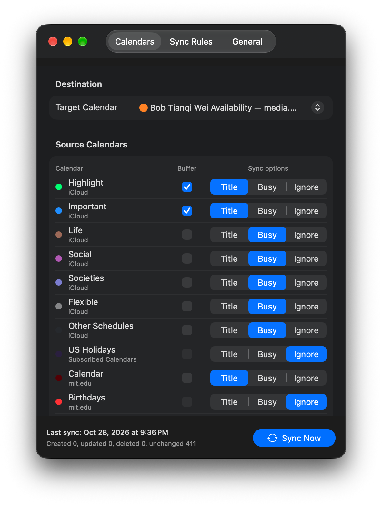
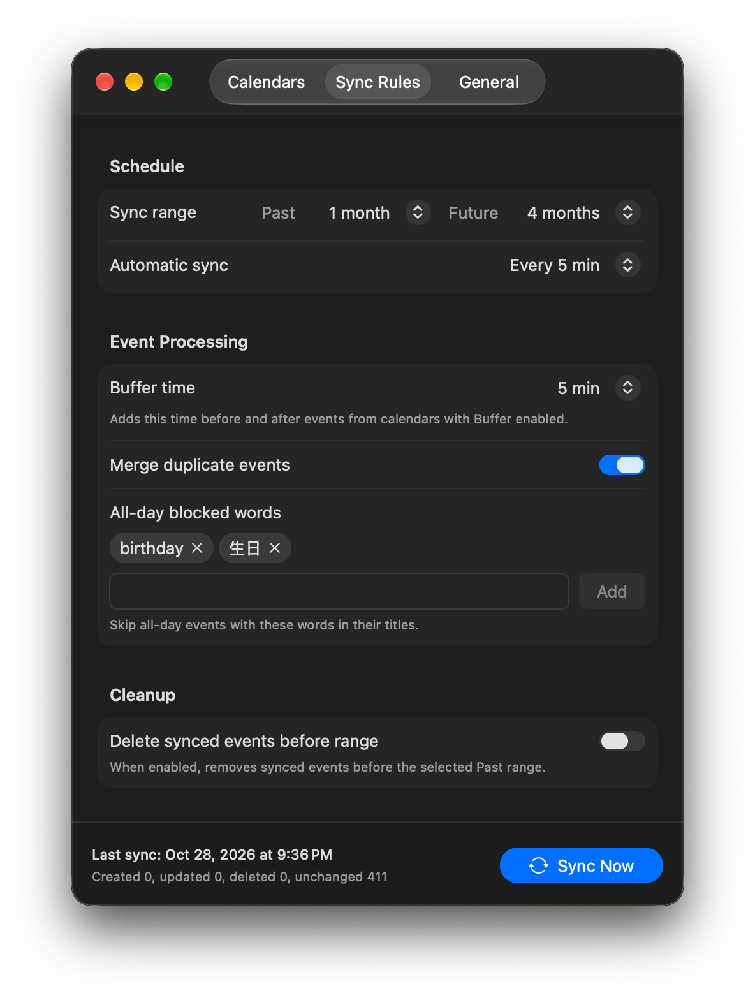
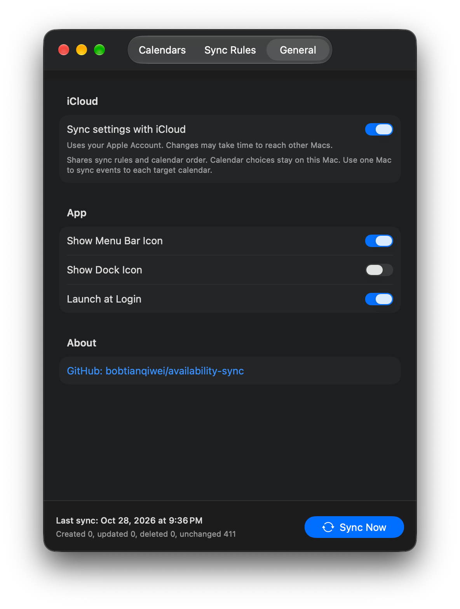

# Availability Sync

Share your availability with coworkers by copying busy time from personal calendars into your work calendar.

[Download for macOS 14+](https://github.com/bobtianqiwei/availability-sync/releases/latest/download/Availability-Sync.zip). Unzip and move Availability Sync.app to Applications.

## Calendars

Grant Full Calendar Access and choose a target calendar. Select **Title** to keep event names, **Busy** to hide them, or **Ignore** to exclude a source. Enable Buffer where needed. Drag calendar names to reorder them; the insertion line shows where they will go.

## Sync Rules

Set past and future ranges, automatic sync intervals, and buffer time. Merge duplicates and filter all-day events by keywords. Recurring and multi-day all-day events are supported. Older synced events are kept by default, with optional cleanup. Click **Sync Now** at any time.

## General

Run from the menu bar, choose whether to show the Dock icon, and launch at login. Automatic syncing continues while the app is running. App updates can be downloaded and installed automatically.

Optional iCloud sync shares general rules and calendar order across Macs using the same Apple Account. Calendar order matches by account and calendar name; unmatched or ambiguous calendars keep their local relative order. Calendar choices and per-calendar rules stay on each Mac. Use one Mac to sync events to each target calendar.

## Privacy

Calendar processing runs locally through EventKit using accounts already added to macOS. Busy events omit source titles, notes, locations, attendees, and account details. The target is excluded from sources; unrelated target events are left untouched.

There is no app account, server, analytics, or telemetry. Optional iCloud sync shares settings and calendar-order identifiers, without event data or event mappings.

## Build

Open `Availability Sync.xcodeproj` in Xcode, select Availability Sync and My Mac, then Run. For iCloud, select your Apple Developer team and enable **iCloud → Key-value storage** in Signing & Capabilities. Use the same team and key-value store identifier across builds.

## License

MIT. See [LICENSE](LICENSE).
